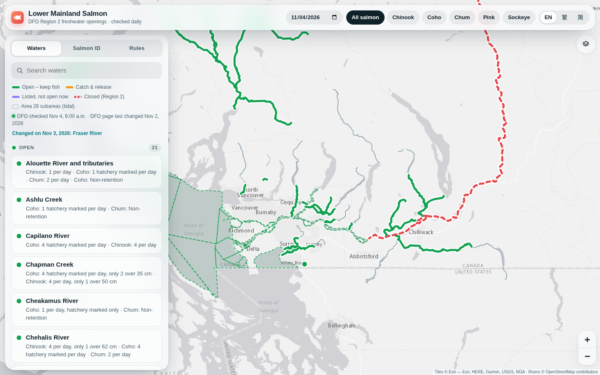
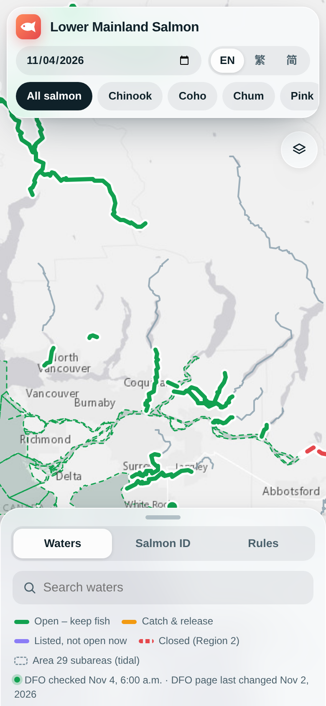
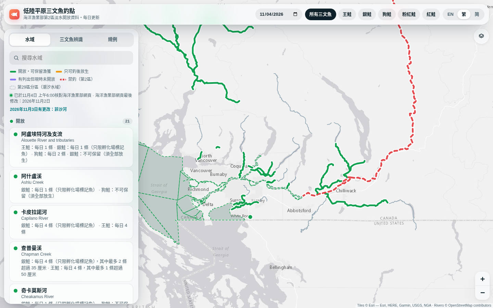

# Lower Mainland Salmon Map

A self-hosted web map of where you can fish for salmon in BC's Lower Mainland. It reads the official DFO regulations for **Region 2 fresh waters** and **tidal Area 29 (the Fraser)**, then colours each river stretch and tidal subarea by what's open on the date and species you pick.

The UI is available in English, 繁體中文 and 简体中文.

**Live site: [salmon.liand.dev](https://salmon.liand.dev/)**

> **Unofficial.** This is a convenience tool, not legal advice. DFO's published regulations and fishery notices always take precedence.



<table>
  <tr>
    <td width="30%"></td>
    <td></td>
  </tr>
  <tr>
    <td align="center"><sub>Mobile</sub></td>
    <td align="center"><sub>繁體中文</sub></td>
  </tr>
</table>

## Features

- **Date and species filter.** Shows which stretches are open, closed or catch-and-release on any day.
- **Real river shapes.** When zoomed in, open stretches are drawn as the river's actual water outline from OpenStreetMap, cut at the boundary points. When zoomed out they're drawn as bold lines.
- **Area 29 subareas.** Boundaries come from DFO's Pacific Fishery Management Subareas map service, and each subarea is coloured by the Salmon-tab rules that apply to it.
- **Daily updates that respect DFO's servers.** Pages are checked once a day with conditional requests, and are only re-parsed when DFO's "Date modified" changes. If DFO is down or the parser breaks, the last good copy is kept.
- **Salmon ID guide.** Photos of the five Pacific species with their key ID marks, plus a diagram of the hatchery adipose-fin clip.
- **No API keys, no AI.** The regulations are parsed deterministically from DFO's HTML tables.

## Quick start (Docker)

You need Docker with the Compose plugin.

```bash
git clone https://github.com/Lian-D/lower-mainland-salmon-fisheries-map.git
cd lower-mainland-salmon-fisheries-map
bash deploy.sh
```

`deploy.sh` does the following:

- creates a `.env` file with a free port and a random refresh token
- builds and starts the container, then waits for it to report healthy
- forces a fresh pull of the DFO pages
- downloads the river outlines and subarea boundaries
- prints the URL

If you'd rather run Compose yourself:

```bash
docker compose up -d --build
```

Then open `http://<host>:3080`.

The app starts with built-in rules (a snapshot from October 2026). Within a few seconds it fetches the live DFO pages and the map geometry. The geometry download can take 30 seconds to 2 minutes. If the Overpass API is busy, it retries every 30 minutes.

### Configuration

Set these in `.env` or `docker-compose.yml`:

| Variable        | Default             | Description                                  |
|-----------------|---------------------|----------------------------------------------|
| `SALMON_PORT`   | `3080`              | Port on the host                             |
| `FETCH_CRON`    | `0 6 * * *`         | When to re-check DFO (cron syntax, in `TZ`)  |
| `TZ`            | `America/Vancouver` | Timezone used by the schedule                |
| `REFRESH_TOKEN` | *(empty)*           | Turns on the manual refresh endpoint when set |

Data is stored in the `salmon-data` Docker volume, mounted at `/data`. The files are `region2.json`, `area29.json`, `rivers-raw.json`, `subareas.json`, `river-areas.json` and `fetch-log.json`.

### API

| Endpoint                                | Description                                              |
|-----------------------------------------|----------------------------------------------------------|
| `GET /api/health`                       | Time of the last DFO fetch and whether it succeeded      |
| `GET /api/regulations`                  | The parsed regulations                                   |
| `GET /api/rivers`                       | River lines, outlines and subarea geometry               |
| `POST /api/refresh?what=regs\|rivers`   | Forces a re-fetch (needs `Authorization: Bearer <token>`) |

```bash
# Re-pull and re-parse both DFO pages now, ignoring the date check
curl -X POST -H "Authorization: Bearer $REFRESH_TOKEN" "http://localhost:3080/api/refresh?what=regs"

# Re-download river lines and Area 29 subareas (for example, after editing geo.ts)
curl -X POST -H "Authorization: Bearer $REFRESH_TOKEN" "http://localhost:3080/api/refresh?what=rivers"
```

## Development

You need Node.js 22 and Python 3. Python generates the test fixtures.

```bash
npm install
npm run dev     # http://localhost:3000, data stored in ./data
npm test        # parser, date logic, river clipping, translation coverage
```

The project uses Next.js 15, React 19, Leaflet, Turf.js and Cheerio.

```
src/
  app/           Next.js pages and API routes
  components/    Map, panels, ID guide
  lib/scrape/    DFO page parsers (Region 2, Area 29)
  lib/geo.ts     Start/end points of each open stretch
  i18n/          Translations
scripts/         Seed and Simplified Chinese generators
test/            Unit tests and saved copies of the live DFO pages
```

### Adjusting the map

The start and end points of each open stretch (bridges, dams, falls) are approximate. They're defined in `src/lib/geo.ts`. If you change a `from`/`to` coordinate and rebuild, the stretch is re-cut from the cached river geometry, so there's no need to re-download it.

If DFO lists a water that isn't in `geo.ts`, it still appears in the side list with a "Not on map yet" badge. To put it on the map, add an entry with its OpenStreetMap waterway name.

### Translations

- Traditional Chinese is written by hand in `src/i18n/zh-Hant.json`. It covers every current DFO area description and general rule.
- Simplified Chinese is generated from it with `npm run i18n:hans`, which uses OpenCC.
- Limit text such as "4 hatchery marked per day, only 2 over 35 cm" is translated by pattern, so new numbers translate automatically.
- When DFO publishes wording that has no translation yet, the app shows the English text with an "English only" badge rather than guessing.

## How Area 29 is parsed

Only the **Salmon tab** of the Area 29 page is read. It contains three tables, and each is parsed directly:

- *Species regulations*: status, daily limit and minimum size for each species and subarea
- *Restrictions*: closures, limits and gear rules, with the season each applies to
- *Area descriptions*: for example, the tidal Fraser is 29-11 and 29-13 to 29-17, plus parts of 29-9 and 29-12

A rule that covers only part of a subarea (for example, the Chapman Creek coho limit in 29-1) is shown as a note and doesn't recolour the whole subarea.

If DFO changes the layout and these tables can't be found, a cruder fallback reader is used and the app says so.

The Salmon tab has its own "Last updated" date, which is newer than the page's metadata date. Change detection uses whichever date is newer.

## Data sources

- Regulations: [Fisheries and Oceans Canada](https://www.pac.dfo-mpo.gc.ca/fm-gp/rec/index-eng.html), Region 2 fresh water and Area 29 tidal pages
- Subarea boundaries: DFO Pacific Fishery Management Subareas (open map service)
- River geometry: © [OpenStreetMap](https://www.openstreetmap.org/copyright) contributors (ODbL), downloaded through the Overpass API
- Base maps: Esri (Light, Dark, Street, Topo, Satellite)
- Salmon photos: U.S. Food and Drug Administration, public domain, via [Wikimedia Commons](https://commons.wikimedia.org/wiki/Category:Oncorhynchus) (FDA 241–245). They're cropped and stored in `public/fish/`.
